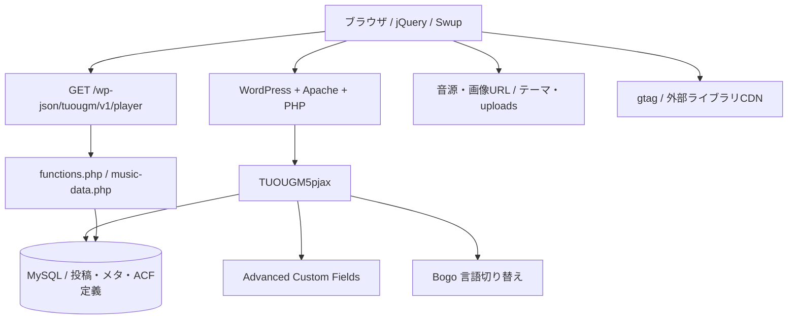

# TUOUGM システム構成解析

調査日: 2026-10-23。ソースの静的解析のみ。DB照会・HTTPアクセス・実機再生・書き込みを伴うWordPress起動は行っていない。補足確認として稼働コンテナのWordPressコアget_footer/get_template_part定義だけを読み取った。本資料の「確認済み」はコード上の確認を指す。有効テーマはAGENTS.mdの指定による。実運用設定・再現試験は「要確認」と記す。

## 1. 全体構成

WordPressがPHPテンプレートを生成し、Swupがヘッダーと本文を差し替える。フッター内プレイヤーは差し替え対象外。音源はAPIレスポンスのURLをHTMLAudioElementで直接読み込む。テーマがCPT、会員処理、REST、管理画面、再生UIを担っている。

## 2. リポジトリと実行環境

| パス | 役割・保存境界 |
| --- | --- |
| `themes/TUOUGM5pjax/` | 現在の主調査対象。テーマ名ヘッダー `TUOUGMver5.0_pjax`、Version 1 |
| `themes/TUOUGM2/`, `TUOUGM3/`, `TUOUGM4/` | 調査時には直下PHPとstyle.cssがなく、音源・画像等の残存資産。過去の完全なテーマとして扱えない |
| `themes/twentytwentytwo/`, `twentytwentythree/`, `twentytwentyfour/` | WordPress標準テーマ。標準資産・ヘッダーと配置を確認、内部実装の詳細解析対象外 |
| `plugins/` | 移行済みプラグイン。テーマと別に機能提供 |
| `archive/ai-article-plugin/` | 転用前の保管物。本調査では変更しない |
| `docker-compose.yml` | `tuougm-site`、WordPressとMySQL、127.0.0.1公開 |
| `docker/php/uploads.ini` | アップロード4G、POST 5G、メモリ512M、時間3600秒 |
| `docker/apache/uploads.conf` | LimitRequestBody 0、Timeout 3600 |
| `.env` | 認証情報。未参照・未転記 |

ComposeのWordPressイメージは `wordpress:6.5-php8.2-apache`、DBは `mysql:8.0`。コアの実際のバージョンはボリュームに依存するため、イメージタグだけでは断定しない。
`themes/` と `plugins/` 全体が書き込み可能なbind mount。WordPress本体・uploadsは `tuougm_site_wordpress_data`、DBは `tuougm_site_db_data`。Gitにはサイトデータ全体は含まれない。

## 3. 主要機能と責務

| 機能 | 実装 |
| --- | --- |
| トップ・記事・会員・Story描画 | 各PHPテンプレート、header.php、footer.php |
| CPTと分類 | functions.php:231–706 |
| 会員レベル管理 | functions.php:710–917、page-members.php、page-upgrade-access.php |
| プレイヤーカタログAPI | functions.php:934–991、inc/music-data.php |
| 永続プレイヤー | footer.php:60–128、js/audio(5)-track-trigger.js |
| PJAX | js/pjax.js、js/common.js |
| 投稿への楽曲ボタン挿入 | inc/tuougm-track-inserter.php |
| コンテンツ生成 | plugins/ai-seo-assistant/。プレイヤーのデータ層ではない |
| 多言語 | Bogoフィルター、[bogo]、テンプレートのloc/get_locale判定 |

## 4. 画面生成から再生まで

1. WordPressがfunctions.phpを読み、CPT・フック・RESTを登録。
2. テンプレートがheader、本文、footerを生成。CSS・JSは主に直接タグで読み込む。
3. footerでREST nonceを `window.tuougmPlayerConfig.restNonce` に渡す。
4. プレイヤーJSがAPIを取得。公開済みアルバムを会員レベルで絞り込み、曲順をACFから得る。
5. 初期アルバムは選択するが音源はまだ読み込まない。ユーザー操作で単一Audioにsrcを設定。
6. Swup遷移後もAudioとJSクロージャは維持。`tuougmInitPage()` は一部のページUIだけを再初期化。

## 5. 依存関係と境界

- **必須依存（確認済み）**: ACF。music-data.phpで `get_field()` を無条件に使用。
- **機能依存（確認済み）**: Bogoのフィルターと `[bogo]`。Classic Editor系UIは `media_buttons`、TinyMCE設定を利用。
- **連携フック（確認済み）**: Post Views Counterの表示抑制。メール送信元の上書き。
- **構成資料上の導入プラグイン**: Autoptimize、Google Site Kit、WP Mail SMTP等。キャッシュ、計測、メールの実効設定はDB側にあり要確認。
- **ブラウザ依存**: jQuery 3.7.1、Modaal 0.4.4、Swup 4、Font Awesome、Google Fonts。WordPressの依存管理を経由しない読み込みが多い。
- **静的配信境界**: 会員レベルによるAPIのフィルターは、音源URLそのものの配信認可とは別。サーバー/CDN側制御は要確認。

## 6. 調査範囲と限界

主テーマのPHP・JS・CSS、旧版ファイルの存在・参照、他テーマの構成、関連プラグインの入口、Docker設定を調査。第三者プラグインの全コード監査は行っていない。
ACFフィールド定義、固定ページのテンプレート割当、公開中コンテンツ、会員レベル別のAPI実レスポンス、音源配信制限、GA4の受信、PJAXの実機挙動は要確認。詳細は [データ構成](wordpress-data.md)、[プレイヤー](audio-player.md)、[技術的負債](technical-debt.md) を参照。

## 7. 調査中のワークツリー変化

開始時のGit状態は `docs/connection-test.md` の未追跡のみだったが、調査中に別途925件のテーマファイル削除状態を検出した。本調査から削除・移動・復元は行っていない。内訳はTUOUGM2 209件、TUOUGM3 210件、TUOUGM4 216件、twentytwentyfour 106件、twentytwentythree 50件、twentytwentytwo 134件。過去・標準テーマについては調査時の存在状態が変化しており、完全な版比較には保管状態の追加確認が必要。資料作成直前に取得した既存ファイルのハッシュは作成後も一致した。
