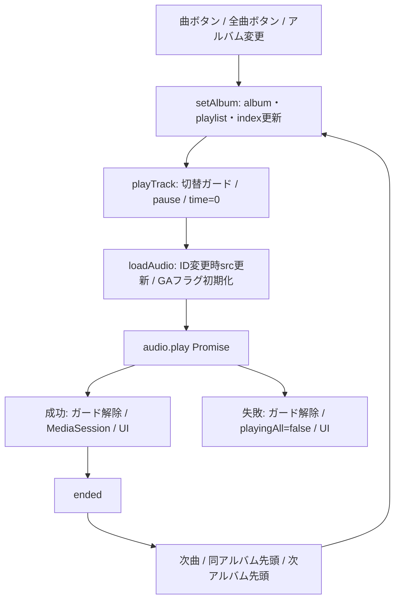

# TUOUGM 音楽プレイヤー解析

2026-10-23、静的解析。実機の音声再生、GA4受信、会員ごとのAPI呼び出しは未実施。主実装は `themes/TUOUGM5pjax/js/audio(5)-track-trigger.js`（797行）。以下のJS行番号はこのファイルを指す。

## 1. 構成と初期化

- `footer.php:60–115`: 常駐 `.player`、アルバム選択、曲一覧、歌詞、seek、前/再生/次/reset。
- `footer.php:123–128`: `window.tuougmPlayerConfig.restNonce` を作り現役JSを読込。
- JS:759 `loadPlayerData()` がDOMContentReady後に実行され、same-origin/no-storeとX-WP-NonceでAPI取得。
- 成功時 `isReady=true` → renderAlbumSelector → initPlayer → 先頭アルバムをsetAlbum(...,false) → 既存ページのaudio-playerを初期化。
- `ensureAudio()`（77付近）が単一 `new Audio()` を生成。一度だけtimeupdate/loadedmetadata/playing/pause/ended/errorを登録。初期選択時はpreload noneで、再生操作まで音源をロードしない。
- API失敗時はconsole.errorのみ。再試行や利用者向け失敗表示はない。

## 2. 状態

| 変数 | 意味 |
| --- | --- |
| playerData | 認可後のAPIカタログ。初回取得後は保持 |
| globalCurrentAudio | 単一HTMLAudioElement |
| globalCurrentAlbum / Playlist / Index | 選択アルバム、曲配列、0始まりの曲番号 |
| globalIsPlayingAll | 再生中UIにも使うフラグ。endedの連続再生を止める判定には使われない |
| isTransitioning | playTrackでplay Promise完了までtrue。多重曲送り抑制 |
| keepActiveDuringTransition | 曲間でもplayerのactive表示を維持 |
| isRepeat | アルバム末尾の戻り先制御 |
| isSeeking | 手動seek中のUI上書き抑制 |
| isReady | API読込完了 |
| audio.dataset.trackId / gaPlayed | 同じ音源の再ロード抑制、GA再送抑制 |

すべてIIFE内。保存先はメモリのみで、localStorageやサーバーへの再生位置保存はない。フルリロードで失われる。PJAXでは同じクロージャとAudioが残る。

## 3. APIとデータ契約

`functions.php:972` の `register_rest_route('tuougm/v1','/player',...)`。GET、permission_callbackは `__return_true`。公開APIだがcallback内でアルバムを絞る。

```text
{ version: 1, access_level: 整数, albums: [
  { id: 文字列, title, title_en, type, artwork, release_date,
    description, required_level: 整数, tracks: [
      { id: 文字列, title, title_en, type, src, lyrics, external_url }
    ] }
] }
```

`tuougm_player_catalog()` → publishのmusic_albumをmenu_order ASC・全件取得 → `tuougm_get_album_data()` → album_tracksの並びで `tuougm_get_track_data()`。
`description` はthe_contentフィルター適用、lyricsは本文から改行維持・HTML除去。音源ACFは配列/ID/URLを受け付ける。release_dateはカスタム発売日ではなく投稿日。

`tuougm_player_access_level()` は匿名0、ログイン時membership_levelの非負整数。required_level以下のアルバムだけ返す。Cache-Controlはprivate/no-store/max-age=0。
アルバム内トラックの公開状態・個別会員レベル判定はmusic-data.phpにはない。標準CPT REST・直接音源配信による別経路は [技術的負債](technical-debt.md) 参照。

## 4. 再生フロー



- `setAlbum()`（302付近）: 状態を先に更新してrenderAlbumView。autoPlay=trueでplayTrack。
- `playTrack()`（233付近）: 切替中なら即return。成功時UI/Media Session更新。catchはエラー表示せずフラグ解除。
- `loadAudio()`（95付近）: 同じtrackIdかつsrcありなら再ロードしない。別曲はpause・src削除・gaPlayed=0・src設定・load。
- pauseはメイン再生ボタン、曲ボタン同曲クリックで実行。reset（588付近）はpause/time=0と選択解除。src自体は除去しない。
- アルバム選択change（440付近）はコメントと異なり `setAlbum(albumId,0,true)` で自動再生する。

## 5. 曲送りとリピートの現在の仕様

| 入力 | 条件 | コード上の動作 |
| --- | --- | --- |
| ended | アルバム途中 | 次曲 |
| ended | 最終曲・repeat ON | 同アルバム先頭 |
| ended | 最終曲・repeat OFF | 次アルバム先頭。最後のアルバムなら先頭アルバムへ循環 |
| ended | 次の候補が空アルバム | それ以降を探索せず停止側へ進む |
| nextクリック / Media Session nexttrack | 途中 | 次曲 |
| nextクリック / Media Session nexttrack | 最終曲 | repeat値に関係なく次アルバムへ循環 |
| prevクリック | 3秒以上経過または先頭曲 | 同じ曲の先頭へ |
| prevクリック | 3秒未満・2曲目以降 | 前曲 |
| Media Session previoustrack | 先頭曲 | 何もしない。通常prevと異なる |

handleEnded（260付近）はglobalIsPlayingAllを判定しないため、個別曲再生からも連続再生する。最終アルバムで終わる仕様ではない。意図する仕様か要確認。
playTrackのガードより前にsetAlbumが状態を変えるため、連打で表示・選択データと実音源がずれる可能性がある。実機再現は未確認。

## 6. 投稿本文・ページ内ボタン

`inc/tuougm-track-inserter.php:545` の `[tuougm_track id="123" label="任意"]` は公開music_trackだけを対象にbuttonを生成。本文内ボタンそのものに会員判定はなく、再生時に認可済みcatalogで見つかる必要がある。

現役JS:619付近のdocument委譲 `click.tuougmTrackTrigger` はIDを文字列化し全アルバムから検索、直接setAlbumする。ラジオchangeを経由しない。同曲はplay/pauseを切り替える。
`.all_btn[data-player-album]` もdocument委譲。対して `.audio-player` の旧曲リストは `initAudioPlayer()` 内で直接bindし、jQuery.dataの数値とAPIの文字列を厳密比較する箇所がある。現トップの数値IDやPJAX再訪と組み合わせた挙動は要確認。
`front-page.php:412` のBANNED曲liはdata-player-trackではなくdata-player-albumを持つ。旧 `.play_btn` が曲を識別できない原因候補。
別ファイル `js/tuougm-track-trigger.js` は旧DOMクリック中継版で、現在のfooterからは読まれない。現役との併用は二重トグルの原因になる。

## 7. PJAX・イベント・共有状態

`pjax.js` のSwup containersは `#swup-header`, `#swup`。`.player`・footer・Audioは残る。page:viewでcommon.jsのtuougmInitPageを呼ぶが、API再取得・initAudioPlayer・Modaal・会員accordion再初期化は含まれない。

- initPlayerはAPI成功時に一度だけ実行。通常PJAXだけでプレイヤーイベントが増える証拠はない。
- initPlayer/initAudioPlayerの多くはnamespace/offなし。将来の再初期化追加には冪等化が必要。
- document委譲の投稿ボタンは差し替え後も有効。旧曲一覧の直接bindは新DOMには付かない。
- visibilitychangeはisTransitioningを無条件解除する。未完了play Promiseとの競合は要確認。
- プレイヤーAPI・nonceは初回ページで固定。PJAX中のログインや権限変更を反映する更新処理はない。

## 8. 表示・歌詞・計測

updateUIはplayer active、曲名、画像、pause/playing、歌詞を更新。各イベントに加えseek更新を500ms intervalで実行。
`lyric.js` はAudioに直接触らず、seekバーと時間表示から進捗を求め、100ms intervalで歌詞を自動スクロール。文字列のMutationObserver、手動スクロール後3秒停止を持つ。タイムスタンプ付き歌詞同期ではない。initにはinitializedガードがある。

GA4はplayingイベント → sendMusicPlayEvent → `window.gtag('event','music_play', {album_id,album_name,track_id,track_name})`。gtag未定義なら送らない。gaPlayed=1で同じロードの一時停止・再開を重複計測しない。同じ曲のrepeatはloadAudioがフラグを戻さないため再計測しない可能性がある。GA設定、同意、実送信・受信は要確認。PJAXページビュー送信も本テーマJSでは確認できない。

## 9. 次工程の検証表

匿名/会員1/2/3でcatalogを比較し、初回・連続next・末尾next・repeat・失敗音源・空アルバム・同曲再選択を検証する。投稿曲ボタン/旧曲一覧/OSメディア操作で結果が一致するか、再生中に複数ページを往復して音声・イベント数・歌詞が維持されるか確認する。本調査では再生やアクセス権変更はしていない。
